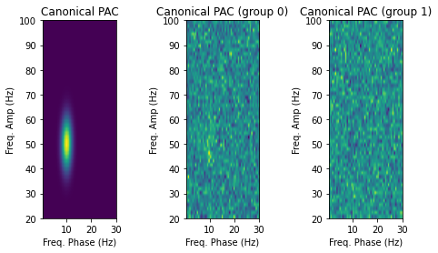
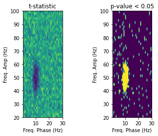
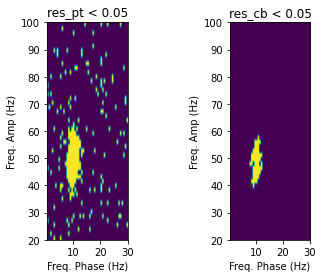
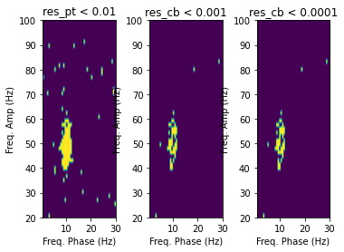

Statistics module tutorial
==========================

In this tutorial, we will focus on how to detect and visualize the
inter-channel PAC modulation via cluster-based permutation testing, and
compare it with the regular permutation testing.

Permutation testing
-------------------

Traditional, parametric approaches to statistical testing have revealed
unuseful in mass univariate problems due to the Multiple Comparison
Problem (MCP). Massive univariate testing yields unnaceptable levels of
false significant regions, so a procedure for controlling the problem
must be used. Family-wise error rate (FWER) such as the Bonferroni
correction arise as overconservative thresholds, proving useless for
this purpose. On the other hand, nonparametric approaches have lately
gained ground, especially with the emergence of massive computational
power.

Permutation testing approaches have flourished among this plethora of
testing methodologies, providing controlled estimation of significance
levels at any given :math:`\alpha` -the statistical significance
threshold-. The procedure that underlies this category is the
approximation of the nonparametric distribution of the data via the
Monte Carlo (MC) method. The simplest approach to permutation testing
would work as follows.

Given a dataset comprising pairs:

.. math::

   (\mathbf{x}_i, y_i), i\in \mathbb{N}

respectively the data and labels of the :math:`i^{th}` sample, let us
call :math:`X` the matrix containing all data from the :math:`k`
samples:

.. math::

   X= \{\mathbf{x}_0, \mathbf{x}_1, \dots \mathbf{x}_k\}

and :math:`\mathbf{y}` the vector containing :math:`k` labels for each
sample.

Permutation testing works by estimating the empirical quantile by:

1. First, we compute a statistical on the data using the real
   :math:`\mathbf{y}` vector, and save it as the reference :math:`z`.
2. Define :math:`z_{emp}` as the empirical quantile reference, as an
   all-zero vector/array.
3. Generate a surrogate label vector, :math:`\hat{\mathbf{y}}`, and
   re-estimate the statistical using :math:`\hat{\mathbf{y}}`, which
   which yields :math:`\hat{z}`.
4. For those features where :math:`\hat{z}>z`, add 1 to :math:`z_{emp}`.
5. Repeat steps 2-3 surrogate procedure :math:`N` times
6. The empirical quantile for each feature is :math:`z_{emp}/N`.

Cluster Based Statistic
-----------------------

Suppose we have 1000 features. If we are performing :math:`N=1000`
iterations over the aforementioned procedure, and checking for
significance with :math:`\alpha=0.05`, the probability of a false
positive is 5%. Over the 1000 features, there is the possibility of 50
false positives appearing.

An alternative is to use a multivariate approach. This can be done via a
plethora of procedures. However, in this case we are using PAC matrices
in which there is a strong dependency in adjacent positions (adjacent
frequencies). We can make use of the “clustering” property, in which
similar frequency interactions yield similar PAC values, to reduce the
number of comparisons.

To do so, we define the cluster-based statistic. The procedure is
similar to the permutation testing approach. However, we will focus on
connected clusters instead of individual positions. The algorithm
becomes:

1. First, we compute a statistical on the data using the real
   :math:`\mathbf{y}` vector, and save it as the reference :math:`z`. -
   same as before-.
2. Threshold :math:`z` using a conservative statistic. E.g., if using
   t-test, use a significance level 0.05, and a high number of degrees
   of freedom. It yields a statistic threshold similar to 1.98.
3. Once umbralized, :math:`z` shows a series of connected clusters.
   Label each of these clusters, and count the number of positions
   within. Keep only those clusters with more than :math:`c_{th}`
   positions.
4. Compute the Cluster-Based statistic :math:`z_{cb}`, by, e.g. summing
   all t-values within that cluster.
5. Define :math:`z_{emp}` as the empirical quantile reference, as an
   all-zero vector/array.
6. Generate a surrogate label vector, :math:`\hat{\mathbf{y}}`, and
   re-estimate the cluster-based statistical using for each cluster,
   which which yields :math:`\hat{z}_{cb}`.
7. For those clusters where :math:`\hat{z}_{cb}>z_{cb}`, add 1 to the
   clusters positions in :math:`z_{emp}`.
8. Repeat steps 6-7 surrogate procedure :math:`N` times
9. The empirical quantile for each feature is :math:`z_{emp}/N`.

To demonstrate how these two methods work, we will perform a toy
example:

.. code:: ipython3

    # Imports
    import numpy as np
    from scipy.stats import multivariate_normal
    import matplotlib.pyplot as plt 

We are going to generate 30 toy PAC connectivity matrices per group for
frequencies ``f_pha=(0.5,30)`` and ``f_amp=(20,100)``, and a coupling
frequency between phase of 10 Hz and amplitude of 50 Hz.

.. code:: ipython3

    f_pha = np.linspace(0.5,30,50)
    f_amp = np.linspace(20,100,50)
    
    coupling_freq = (10, 50) #this is the coupling frequency for phase - amplitude.
    
    xx, yy = np.meshgrid(f_pha, f_amp)
    canonical_pac = 50*multivariate_normal.pdf(np.stack((xx, yy), axis=-1), 
                                       mean=coupling_freq, cov=[[2,0.5],[0.2,50]])
    
    # And this is the generator of toy_pacs
    def toy_pac(canonical_pac, group=0.):
        toy_pac = (group+np.random.randn(1))*canonical_pac
        toy_pac += .5*np.random.randn(*canonical_pac.shape)
        return toy_pac
    
    # We display the canonical pac
    fig, ax = plt.subplots(1, 3, figsize=(8,4))
    ax[0].imshow(canonical_pac, origin='lower', 
               extent=(f_pha.min(), f_pha.max(), f_amp.min(), f_amp.max()))
    ax[0].set_xlabel('Freq. Phase (Hz)')
    ax[0].set_ylabel('Freq. Amp (Hz)')
    ax[0].set_title('Canonical PAC')
    
    # generate a toy pac for group 0
    ax[1].imshow(toy_pac(canonical_pac, 0), origin='lower', 
               extent=(f_pha.min(), f_pha.max(), f_amp.min(), f_amp.max()))
    ax[1].set_xlabel('Freq. Phase (Hz)')
    ax[1].set_ylabel('Freq. Amp (Hz)')
    ax[1].set_title('Toy PAC (group 0)')
    
    # generate a toy pac for group 1
    ax[2].imshow(toy_pac(canonical_pac, 1), origin='lower', 
               extent=(f_pha.min(), f_pha.max(), f_amp.min(), f_amp.max()))
    ax[2].set_xlabel('Freq. Phase (Hz)')
    ax[2].set_ylabel('Freq. Amp (Hz)')
    ax[2].set_title('Toy PAC (group 1)')

Now we generate the labels for the 60 subjects, 30 for group 0 and 30
for group 1, and their corresponding pac:

.. code:: ipython3

    y = np.r_[np.ones(30), np.zeros(30)]
    X = np.stack([toy_pac(canonical_pac, group) for group in y])
    print(X.shape)

.. parsed-literal::

    (60, 50, 50)

Let’s check what happens with traditional statistical testing. Given our
approach, only the cluster should be significant.

.. code:: ipython3

    from scipy.stats import ttest_ind
    
    test = ttest_ind
    alpha = 0.05 # significance level
    
    raw_test, pval = test(X[y==0],X[y==1])
    
    fig, ax = plt.subplots(1,2)
    # generate a toy pac for group 0
    ax[0].imshow(raw_test, origin='lower', 
               extent=(f_pha.min(), f_pha.max(), f_amp.min(), f_amp.max()))
    ax[0].set_xlabel('Freq. Phase (Hz)')
    ax[0].set_ylabel('Freq. Amp (Hz)')
    ax[0].set_title('t-statistic')
    
    # generate a toy pac for group 1
    ax[1].imshow(pval<alpha, origin='lower', 
               extent=(f_pha.min(), f_pha.max(), f_amp.min(), f_amp.max()))
    ax[1].set_xlabel('Freq. Phase (Hz)')
    ax[1].set_ylabel('Freq. Amp (Hz)')
    ax[1].set_title(f'p-value < {alpha}')

In the regular testing, appart from the original cluster, there appear
many spurious areas across all frequencies. If this is the case only for
a toy example with gaussian noise, what could not happen to the real
case? There, there are many intra and inter-channel couplings, spurious
peak, and inter-subject variability. Let’s check what happens when we
apply permutation testing.

.. code:: ipython3

    from functionalpac.statistics import PermutationTesting, ClusterBasedPermutationTesting
    
    n_iter = 1000
    output = 'quantile'
    cbth = 5
    twosided = True
    
    pt = PermutationTesting(n_iter=n_iter, alpha=alpha, test=test, output=output, twosided=twosided)
    cbpt = ClusterBasedPermutationTesting(n_iter=n_iter, alpha=alpha, test=test, 
                                          output=output, cluster_threshold=cbth, twosided=twosided)
    
    # Careful with X-shape, wich is expecting (n_subj, n_chan, n_chan, n_pha, n_amp)
    res_pt = pt.fit(X.reshape((-1,1,1,len(f_pha), len(f_amp))),y)
    res_cb = cbpt.fit(X.reshape((-1,1,1,len(f_pha), len(f_amp))),y)

.. parsed-literal::

    [Parallel(n_jobs=10)]: Using backend ThreadingBackend with 10 concurrent workers.
    [Parallel(n_jobs=10)]: Done   1 tasks      | elapsed:    0.0s
    [Parallel(n_jobs=10)]: Done   2 tasks      | elapsed:    0.0s
    [Parallel(n_jobs=10)]: Done   3 tasks      | elapsed:    0.0s
    [Parallel(n_jobs=10)]: Done   4 tasks      | elapsed:    0.0s
    [Parallel(n_jobs=10)]: Done   5 tasks      | elapsed:    0.0s
    [Parallel(n_jobs=10)]: Done   6 tasks      | elapsed:    0.0s
    [Parallel(n_jobs=10)]: Done   7 tasks      | elapsed:    0.0s
    [Parallel(n_jobs=10)]: Done   8 tasks      | elapsed:    0.0s
    [Parallel(n_jobs=10)]: Done   9 tasks      | elapsed:    0.0s
    .
    .
    .
    [Parallel(n_jobs=10)]: Done 979 tasks      | elapsed:    1.4s
    [Parallel(n_jobs=10)]: Done 980 tasks      | elapsed:    1.4s
    [Parallel(n_jobs=10)]: Done 981 tasks      | elapsed:    1.4s
    [Parallel(n_jobs=10)]: Done 1000 out of 1000 | elapsed:    1.4s finished

After performing 1000 iterations, we obtain the results for the regular
permutation testing and the cluster-based one:

.. code:: ipython3

    fig, ax = plt.subplots(1,2)
    # generate a toy pac for group 0
    ax[0].imshow(res_pt[0,0]<alpha, origin='lower', 
               extent=(f_pha.min(), f_pha.max(), f_amp.min(), f_amp.max()))
    ax[0].set_xlabel('Freq. Phase (Hz)')
    ax[0].set_ylabel('Freq. Amp (Hz)')
    ax[0].set_title(f'res_pt < {alpha}')
    
    # generate a toy pac for group 1
    ax[1].imshow(res_cb[0,0]<alpha, origin='lower', 
               extent=(f_pha.min(), f_pha.max(), f_amp.min(), f_amp.max()))
    ax[1].set_xlabel('Freq. Phase (Hz)')
    ax[1].set_ylabel('Freq. Amp (Hz)')
    ax[1].set_title(f'res_cb < {alpha}')

.. parsed-literal::

    Text(0.5, 1.0, 'res_cb < 0.05')

As it can be seen, the cluster-based approach is a much more
conservative approach. However, it was able to clean all false positive
positions and clusters. This was not possible even if we choose a more
restrictive alpha threshold for the regular permutation testing:

.. code:: ipython3

    fig, ax = plt.subplots(1,3)
    # generate a toy pac for group 0
    ax[0].imshow(res_pt[0,0]<0.01, origin='lower', 
               extent=(f_pha.min(), f_pha.max(), f_amp.min(), f_amp.max()))
    ax[0].set_xlabel('Freq. Phase (Hz)')
    ax[0].set_ylabel('Freq. Amp (Hz)')
    ax[0].set_title(f'res_pt < 0.01')
    
    # generate a toy pac for group 1
    ax[1].imshow(res_pt[0,0]<0.001, origin='lower', 
               extent=(f_pha.min(), f_pha.max(), f_amp.min(), f_amp.max()))
    ax[1].set_xlabel('Freq. Phase (Hz)')
    ax[1].set_ylabel('Freq. Amp (Hz)')
    ax[1].set_title(f'res_cb < 0.001')
    
    # generate a toy pac for group 1
    ax[2].imshow(res_pt[0,0]<0.0001, origin='lower', 
               extent=(f_pha.min(), f_pha.max(), f_amp.min(), f_amp.max()))
    ax[2].set_xlabel('Freq. Phase (Hz)')
    ax[2].set_ylabel('Freq. Amp (Hz)')
    ax[2].set_title(f'res_cb < 0.0001')

.. parsed-literal::

    Text(0.5, 1.0, 'res_cb < 0.0001')

